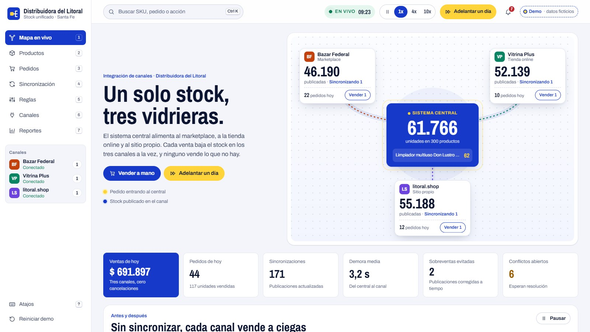

# Integración de canales · Distribuidora del Litoral (demo)

**Un solo stock, tres vidrieras.** Demo de portfolio de un sistema central que alimenta a tres canales de venta (un marketplace, una tienda online y un sitio propio) para una distribuidora ficticia de productos de limpieza de Santa Fe. Cada pedido recorre el sistema en vivo: entra por un canal, baja el stock central y se publica en los otros dos en segundos.

Todo es ficticio: la empresa, los canales (Bazar Federal, Vitrina Plus, litoral.shop), los productos, los clientes y los comprobantes. No se conecta a ninguna plataforma real ni a AFIP. Sin backend, sin APIs: todo corre en el navegador.



## Cómo correrlo

Requisitos: Node 22.12+ y pnpm.

```bash
pnpm install
pnpm dev        # http://localhost:4631
pnpm build      # genera dist/ (estático)
pnpm preview    # sirve dist/ en http://localhost:4631
pnpm check      # astro check (tipos estrictos)
```

## Qué hay adentro

| Ruta | Vista |
| --- | --- |
| `/` | **Mapa en vivo**: el sistema central y los tres canales con pulsos por los cables, KPIs en vivo y las escenas del brief (antes/después, ficha de producto, registro de eventos, cola de pedidos, reglas). |
| `/productos` | Los 300 productos con stock central y publicado por canal, filtros, orden, búsqueda y exportación CSV. |
| `/productos/[sku]` | Ficha: stock por canal con contador de demora, precio y margen por canal, ajuste de inventario, gráfico del mes e historial de movimientos. |
| `/pedidos` | Pedidos de hoy en vivo y los 800 de octubre. Cada pedido abre su línea de tiempo, factura simulada y etiqueta de envío generada en el navegador (descargable en SVG). |
| `/sincronizacion` | Registro de eventos en vivo, cola por canal con reintentos y bandeja de conflictos para resolver. |
| `/reglas` | Reserva de stock por canal, stock de seguridad, pausa de publicaciones, recargos de precio y "el central siempre gana". |
| `/canales` | Conexiones simuladas: conectar o cortar un canal, cambiar su demora o su tasa de errores, probar la conexión. |
| `/reportes` | Ventas de octubre por día y canal, cancelaciones antes y después de la integración, más vendidos y la actividad de hoy por hora. |

### Capa en vivo

Un único motor de simulación (`src/scripts/sim.ts`) alimenta todas las vistas a través de un store compartido (`src/scripts/store.ts`), persistido en `localStorage`:

- ventas que llegan de cada canal, stock que baja en los tres a la vez;
- trabajos de sincronización con demora, errores, reintentos con espera exponencial y conflictos;
- notificaciones con contador de no leídas, registro de eventos y KPIs que se actualizan;
- indicador **EN VIVO**, pausa y velocidades 1x / 4x / 10x, y **Adelantar un día** (un día de pedidos en unos segundos);
- **Reiniciar demo** borra la sesión guardada.

### Teclado

`Ctrl/Cmd + K` paleta de comandos · `/` buscar · `1`–`7` vistas · `P` pausa · `S` velocidad · `F` adelantar un día · `V` venta manual · `N` notificaciones · `?` ayuda.

## Modo vitrina y póster

`?showcase` recorre solo todo el producto en un loop de unos 28 segundos, sin cursor, para grabar el video del portfolio. Siempre arranca de un estado limpio y nunca toca la sesión guardada del visitante.

Para grabar:

1. `pnpm build && pnpm preview`
2. Abrí `http://localhost:4631/?showcase` en una ventana de 1600×900 (o 1920×1080) y grabá con cualquier capturador de pantalla.

Para regenerar el póster (`public/poster.jpg`, 1600×900, tomado de la página real con Playwright):

```bash
pnpm build && pnpm preview   # en otra terminal
pnpm poster
```

## Calidad

`pnpm test:e2e` (con el preview corriendo) recorre todas las vistas en escritorio, a 390 px y con movimiento reducido, prueba los atajos de teclado y las transiciones de vista, corre un loop completo del modo vitrina y falla ante cualquier error o advertencia en consola, desborde horizontal o escritura en la sesión guardada.

- Animación solo con `transform` y `opacity` (más SVG). GSAP con MotionPathPlugin y Flip se carga después del primer pintado.
- Con `prefers-reduced-motion` la demo es estática y completa: la simulación arranca en pausa y las escenas muestran su estado final.
- A 390 px hay una composición propia: mapa vertical, barra de pestañas inferior y tablas convertidas en tarjetas, sin scroll lateral.
- Los datos (300 productos, 800 pedidos) se generan con una semilla fija en `src/data/`; no hay datasets en el repositorio.

## Stack

Astro 7 (salida estática, View Transitions), TypeScript estricto, CSS con variables, GSAP 3 (MotionPathPlugin, Flip), SVG. Fuentes: Archivo Narrow (cantidades) y Archivo (texto).
